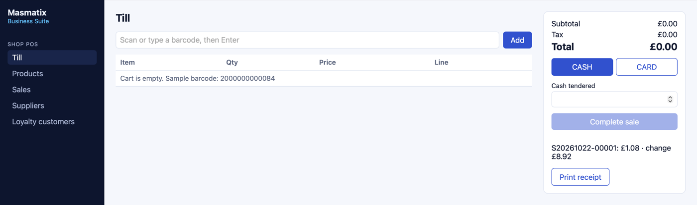
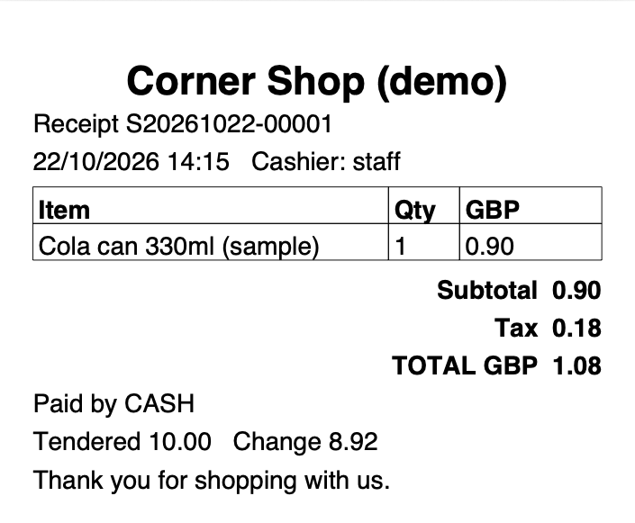

# Masmatix Business Suite

Small-business systems (shop till, bookings, clinic, gym, hotel and more) built on one shared base, by **Masmatix Innovations**.

This repository rebuilds, from scratch, the kinds of systems our team has delivered for shops and service businesses. It contains no client code and no client data: every name, product and barcode in the sample data is invented and marked "(sample)".

**Status:** all 20 systems are complete on one shared base. The generator builds each system's records, forms, validation, CSV export and audit trail from a spec file; every system then has its own hand-written desk screen and business rules on top (till, diary, fees, fines, net weight, loan schedule and so on), each with tests.

| Till screen | Printed receipt (PDF) |
|---|---|
|  |  |

*Screenshots from a local run with the invented sample data.*

## What is in it

| Part | Tech | What it does |
|---|---|---|
| `backend/` | Java 21, Spring Boot 3, Spring Security (JWT), JPA, PostgreSQL | REST API, roles, audit log, PDF receipts, CSV export |
| `frontend/` | React 18, TypeScript, Vite | One desk screen per system (till, diary, work list, loading list, weighbridge, loan desk, hearing calendar and others) plus record screens |
| `tools/generator/` | Python 3.9+ (standard library only) | Builds entity, repository, REST controller and screen definition from a JSON spec |
| `specs/` | JSON | One spec file per system |
| `docker-compose.yml` | Docker | Database, API and web app with one command |

### Shared base (written once, used by every system)

- **Login and roles:** `ADMIN`, `MANAGER`, `STAFF`. Stateless JWT tokens, BCrypt passwords.
- **Generic CRUD:** list, read, create, update, delete, CSV export for any entity, with the same role rules everywhere (staff read, managers edit, admins delete).
- **Audit log:** every create, update, delete, sale and login is recorded with user and time.
- **PDF documents:** one builder for receipts, invoices and prescriptions (80 mm receipt or A4).
- **CSV export:** with protection against spreadsheet formula injection.
- **Errors:** RFC 7807 problem responses, so the UI shows one consistent message format.

### Shop POS

- Barcode lookup: a USB scanner types the code and presses Enter; the till adds the item.
- Cart with quantity limits based on stock.
- Checkout for cash (tendered and change) or card. Stock is locked per row during checkout, so two tills cannot sell the last item twice.
- Tax per product (e.g. 20% standard VAT, 0% for zero-rated food), rounded half-up per line. The backend (`PricingCalculator.java`) and the till screen (`cart.ts`) use the same rule, and both have tests with the same numbers.
- Printable PDF receipt for each sale.
- Daily takings report (count, subtotal, tax, cash vs card).
- Low-stock list (`/api/pos/products/low-stock`).
- Suppliers and loyalty customers, built by the generator from `specs/pos.json`.

### Salon and spa booking

- Diary per stylist for any day, with free start times for the chosen treatment (15-minute steps, 09:00 to 18:00).
- No double booking: the stylist row is locked while a booking is saved, and overlaps are checked with half-open times, so 10:00 to 10:45 and 10:45 to 11:30 can both be booked.
- Rejects past times, times off the quarter hour and treatments that would run past closing.
- Cancel or mark done; a cancelled slot becomes free again.
- Stylists and treatments (length, price, category) come from `specs/salon.json`.

### Clinic prescription writer

- Prescription with up to 10 medicines (dose, frequency, days, instructions), printed as an A4 PDF with a signature line.
- Allergy warning: if a medicine's name or ingredient matches the patient's recorded allergies, saving is refused until the prescriber gives an override reason. The override is printed and written to the audit log.
- The patient's name, date of birth and allergies are copied into the prescription, so later edits to the patient record do not change an issued prescription.
- Only `MANAGER` and `ADMIN` (standing in for the prescriber) can write; `STAFF` can view and print.
- Patients and the medicine list come from `specs/clinic.json`.

### Gym membership and fees

- Front desk check-in by member code (typed or scanned). Expired, frozen and unknown members are blocked, and every attempt is logged.
- A membership is valid up to and including its expiry date.
- Taking fees: paying early extends from the current expiry (no paid days lost); paying after expiry starts from today. Month ends follow the calendar (31 January plus one month is 28 or 29 February).
- Fee receipt PDF, list of memberships ending in the next 7 days, payment history per member.
- Plans (months, fee) come from `specs/gym.json`.

### Hotel booking and check-in

- Availability search by dates and number of guests.
- A room cannot be sold twice for the same night: the room row is locked while booking, and stays use half-open dates, so one guest can leave on the day the next arrives.
- Checks room capacity, past dates and a 30-night limit; price is nightly rate x nights.
- Front desk lists today's arrivals and guests in house. Check-in only from the arrival date; check-out only after check-in; only reservations can be cancelled (managers).
- A4 invoice PDF per booking. Rooms come from `specs/hotel.json`.

### Garment shop

- Till by style code (one code per style, size and colour, e.g. `KRT-101-M-BLU`), scanned or typed. Stock is locked per row during the sale.
- Cash or card, change due, and an 80 mm PDF receipt with a receipt number. Prices include VAT, as on UK clothing tags.
- Exchanges from the receipt within 30 days: the returned item must be on that receipt and not already exchanged. The screen and the API show the price difference (customer pays more, refund, or even swap).
- A returned item goes back on the shelf, except when the reason is `FAULT`. Every exchange is recorded with the old and new style codes and the difference.
- Low-stock list (3 or fewer).

### Mobile IMEI tracker

- IMEI check digit (Luhn): a handset with a mistyped IMEI cannot be saved, and the desk screen says so while typing. Swapping two neighbouring digits is caught.
- Warranty status by IMEI: cover runs to the day before the same date N months after sale (12 months from 2 Aug 2026 ends on 1 Aug 2027).
- A warranty claim opens only for a handset this shop sold, inside its cover, with no other claim still open for it.
- List of handsets whose cover ends in the next 30 days, with the customer's phone, for reminder calls.

### Bakery

- New batch: the sell-by date is set from the item's shelf life (baked on 24 Oct with 3 days: sell up to and including 27 Oct), with a batch code per day.
- Counter sale takes stock from the batch that expires first and never sells an expired batch. If fresh stock is short, nothing is sold.
- Expiry alerts: batches with stock that are expired, on their last day or ending tomorrow.
- Managers write off what is left of a batch; the quantity and the user go to the audit log.

## Run it

Needs [Docker Desktop](https://www.docker.com/products/docker-desktop/).

```bash
cp .env.example .env
# put a real secret in .env:  APP_JWT_SECRET=$(openssl rand -hex 32)
docker compose up --build
```

- Web app: http://localhost:3000 (users `admin`, `manager`, `staff`, password = `APP_DEMO_PASSWORD` from `.env`)
- API docs (OpenAPI / Swagger UI): http://localhost:8080/swagger-ui.html

The first build downloads Maven and npm packages and runs all tests inside the build, so it takes a few minutes.

Try a sample barcode on the till: `2000000000084`. On the gym desk, try member codes `GYM-0001` (active), `GYM-0002` (expired) and `GYM-0003` (frozen). On the IMEI desk, try `000000000000018` (in warranty), `000000000000034` (cover ended) and `000000000000019` (wrong check digit). Sample IMEIs use the `00` prefix, so they do not belong to any real phone. Sample barcodes use the 200 to 299 in-store prefix range, so they do not belong to any real product.

## Tests

| Where | What is tested | Command |
|---|---|---|
| `backend/src/test` | Every seeded entity of all 20 systems: list and CSV export. POS: money rounding, login, barcode lookup, sale totals, stock, receipt, role rules, generated CRUD and CSV, audit. Salon: overlap, back-to-back, opening hours, free slots, cancel. Clinic: allergy block and override, prescriber role, print. Gym: expiry day, early and late renewal, month ends, frozen and unknown codes. Hotel: double booking, same-day turnover, capacity, check-in and check-out order, invoice. Garment: sale, stock, receipt, exchange once per item. IMEI: check digit, warranty, one open claim. Bakery: shelf life, oldest batch first, expired never sold, write-off role. Lab, coaching, library, tailoring, travel, wholesale, weighbridge, construction, housing, payroll, micro-finance and law firm: each rule (`ServiceRulesTest`) and each desk endpoint end to end (`ServiceSystemsApiTest`) | `cd backend && mvn test` |
| `frontend/src/lib/*.test.ts` | cart totals, stay nights and totals, renewal dates, IMEI check digit, warranty end, expiry status, exchange difference, library fine, tailoring balance, net weight and travel checklist match the backend numbers | `cd frontend && npm test` |
| `tools/generator/test_generate.py` | generated code shape; bad specs, duplicate entity names and SQL reserved field names rejected; every spec in `specs/` builds | `python3 -m unittest discover -s tools/generator` |

The Docker build runs the backend and frontend tests, so `docker compose up --build` fails if a test fails.

## Adding a system with the generator

A system is a JSON file in `specs/`. Example field types: `string`, `text`, `int`, `decimal`, `bool`, `date`, `email`, `phone`, `enum`.

```json
{
  "system": "gym",
  "title": "Gym membership",
  "entities": [
    { "name": "Member", "label": "Members", "path": "members",
      "fields": [
        { "name": "fullName", "type": "string", "required": true },
        { "name": "plan", "type": "enum", "values": ["MONTHLY", "ANNUAL"] },
        { "name": "expiresOn", "type": "date" }
      ] }
  ]
}
```

```bash
python3 tools/generator/generate.py          # writes the Java and the screen definition
python3 tools/generator/generate.py --check  # fails if generated files are out of date
```

### Diagnostic lab

- Work list of samples not yet reported, oldest first. Status moves collected, in progress, reported; a reported result is final (a correction needs a new order).
- The result is flagged LOW, NORMAL or HIGH against the test's range (`4.0-11.0`, `< 5.7` or `> 60`); text results get no flag.
- Printed report (PDF) only after the result is in. Sample ranges are invented; this is not a medical device.

### Coaching centre

- Fee payment for 1 to 12 months with an on-screen receipt. A missed month is still owed, so payment extends from the old paid-until date (unlike the gym).
- Overdue list with months owed and the amount from the batch's monthly fee.

### Library

- Issue only while a copy is free (copies minus open loans); due in 14 days.
- Return works out the fine: 0.20 a day after the due date, at most 10.00 a loan. A loan cannot be returned twice. Overdue list with the fine so far.

### Tailoring

- Order board by stage: cutting, stitching, trial, ready. Balance due is price minus advance (never below zero).
- A ready order is delivered only when the exact balance is paid. Order slip (PDF) with measurements, dates and balance.

### Travel agency

- Checklist per booking: passport, visa (not needed for flight-only bookings; a refusal is shown) and balance.
- Call list of trips in the next 14 days with something missing. No messages are sent.

### Wholesale distribution

- Loading list per route and date with order count and total; refused if the route does not run on that weekday.
- Mark all loaded, then delivered per order. Orders move booked, loaded, delivered; only a booked order can be cancelled.

### Mill weighbridge

- Net weight from gross and tare. Refused when tare is 0, gross is not more than tare (swapped weighings) or gross is over the 60,000 kg bridge limit. The screen shows the same check while typing.
- Numbered slips (`WB-000001` onwards) as an 80 mm PDF, and today's net kg per material.

### Construction materials

- Cost dashboard per site: materials by type (quantity times unit cost), labour (workers times daily rate), share of each and the site total.

### Housing society

- Overdue instalments with days late; mark one paid.
- Managers allot an available plot or transfer an allotted one. A transfer is refused while that plot has overdue instalments; old and new owner go to the audit log.

### Payroll and attendance

- Check-in works out minutes late and the fine. Sample rules: 10 minutes' grace, then every late minute at the per-minute rate (monthly salary / 26 days / 8 hours); overtime at 1.5 times. One check-in per employee per day.
- Monthly pay summary: salary, fines, overtime and net. Fines are worked out again from late minutes, so a hand-edited fine cannot drift from the rule.

### Micro-finance

- Statement with the repayment schedule (first instalment one month after the start), each instalment paid, part paid, upcoming or overdue, plus arrears and amount left.
- A repayment records a late fee of 2% of the arrears when instalments are overdue (sample default). Overpaying is refused; the loan closes when fully repaid.

### Law firm case diary

- Hearing calendar for the next 7, 14 or 30 days with case, court and client.
- A new date is refused for a decided or closed case, a past date, or a second hearing for the same case on one day.
- Outcome on or after the hearing day: adjourned (the next date is added) or decided.

Each entity gets a table, validation, REST endpoints under `/api/<system>/<path>`, OpenAPI docs, CSV export, audit entries and a screen in the web app. Hand-written features (like the till) sit beside the generated code.

## Roadmap

Systems with hand-written features on top of the generated base:

- [x] Shop POS: barcode till, receipts, stock, daily report
- [x] Salon and spa booking: diary, free slots, no double booking
- [x] Clinic prescription writer: allergy warning, printable prescription
- [x] Gym membership and fees: entry blocked after expiry, fee receipts
- [x] Hotel booking and check-in: availability, no double booking, invoices
- [x] The other 15 systems from [masmatixinnovations.co.uk](https://masmatixinnovations.co.uk/#systems), each with its own desk screen and rules

## Limitations

- Tables are created by Hibernate (`ddl-auto: update`). A production install should use versioned migrations (Flyway).
- Card payments are recorded, not processed: there is no payment terminal integration.
- The clinic module is sample software, not a medical device. The allergy check is a plain text match against the patient's recorded allergies; it does not replace a drug database or clinical judgement, and printed prescriptions say they are not valid for dispensing.
- Salon opening hours (09:00 to 18:00) and the hotel's 30-night limit are constants in code, not settings yet.
- Receipts are plain sales receipts. They are not certified for any tax authority's e-invoicing scheme.
- Records in the newer systems link by number or name as text (for example a loan repayment stores the loan number), not by foreign key. Desk lists read whole tables, which is fine for a small business but would need paged queries at scale.
- Fines, late fees, grace periods, loan periods and the bridge limit are sample defaults in code, not settings yet. Check local law and your own policy before using them.
- Not built: weighbridge and biometric hardware links, lab analyser interface, document store for the law firm, SMS or WhatsApp reminders.
- The demo users share one password from `.env`. Change it, and the JWT secret, before any real use.

## Licence

MIT. Copyright (c) 2026 Masmatix Innovations Ltd.
